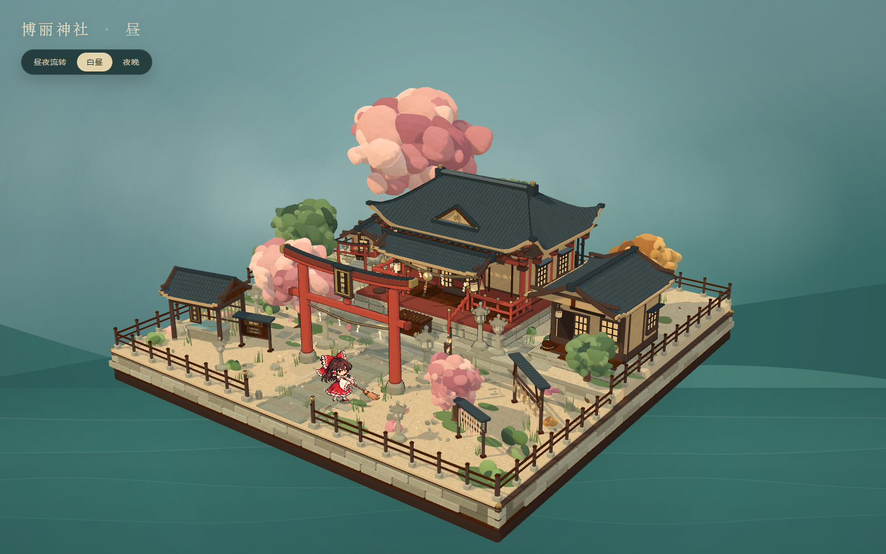
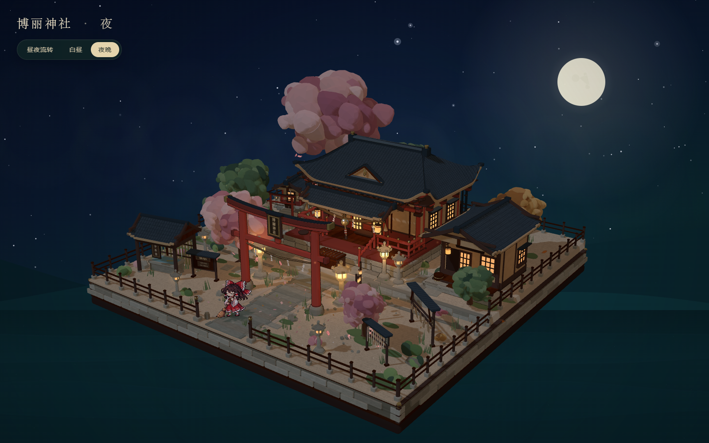
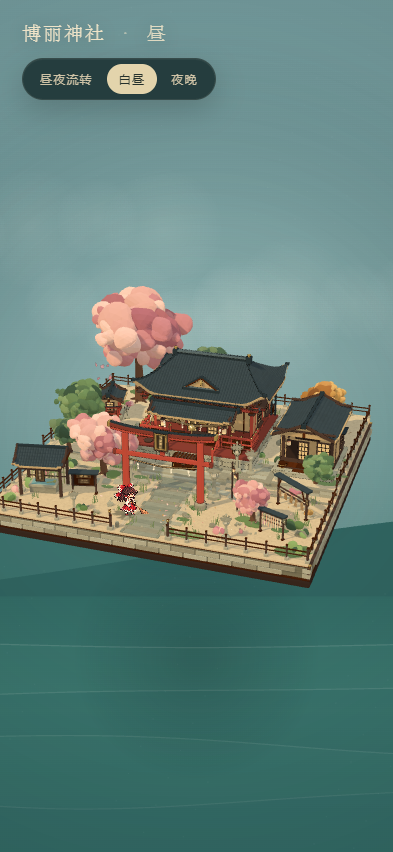

# 博丽神社 · 幻想乡的一隅

一个使用 Three.js 制作的博丽神社微缩立体场景。正方形庭院底座漂浮在柔和的幻想乡水面之上，正殿、鸟居、参道、手水舍、绘马架、御神签架与社务所共同组成完整的神社院落；Q 版像素灵梦会在前院扫地、转身、跳向下一个空地，昼夜会自动流转，也可以手动切换。

当前版本：`0.1.1`

在线预览：<https://xingxuan-sivan.github.io/hakurei-shrine-diorama/>

本轮修订重点：主殿两侧山墙的窗户重做为每侧两扇、分别落在前后两个木构开间内的障子窗，加独立的深木窗台、小瓦檐和檐下支木，左右完全对称；主殿大门的两扇障子收窄并贴到门洞两侧，中央留出完整的暖光门洞，门洞内只保留深处的暖光壁面与祭坛，不再用贴在门槛上的发光面遮挡室内；侧墙去掉多余的侧门；后墙保持左右对称的两扇亮窗；绘马架与御神签架的牌匾都改为装在各自架子的右侧立柱上，并整体压低避开屋檐，不再穿模或继续放在架子顶上。

`0.1.1` 修复手机竖屏初始机位把灵梦裁出画面外的问题：移动端自动使用更广的视场、更正面且更远的机位，保证完整底座与灵梦同时入镜；横竖屏切换时重新构图，并限制像素比与阴影贴图尺寸。







## 运行

```bash
npm install
npm run dev
```

打开终端提示的地址（默认 `http://127.0.0.1:5199/`）。

生产构建与预览：

```bash
npm run build
npm run preview
```

## 部署

推送到 `main` 后，GitHub Actions 会自动执行 `npm ci`、`npm run build`，并把 `dist/` 发布到 GitHub Pages。线上地址：<https://xingxuan-sivan.github.io/hakurei-shrine-diorama/>。

## 操作

- 鼠标拖拽 / 单指拖动：旋转视角
- 滚轮 / 双指捏合：缩放
- 点一下灵梦：她停下手里的活、转向镜头说一句话（12 句台词随机，短时间不重复）
- 点一下正殿的障子门：两扇拉门滑开或合上（引分け遣戸，门扇退到柱子内侧，开到底仍露出小半扇）
- 点一下赛钱箱：投一枚硬币进去
- 点一下御神签架：抽一支签，签文在画面里展开，再点空白处收回；一支签管神社里的一整天，同一天反复点只会重看同一张，跨过日出才会换
- 点一下树：树冠抖动、落叶从枝头簌簌落下（同样受雨/风的影响）
- 悬停在可点的东西上光标会变成手型；双击空白处回到初始机位
- 左上角时间条：拖动或点击刻度即可把时间拨到任意时刻，背景的日月会随之沿弧线移动、天色与水色连续过渡、影子方向也跟着转；左侧按钮显示当前状态，自动流转时是「自动」，一拖时间就变成高亮的「锁定」，再点一下恢复自动（约 150 秒一天）
- 也支持 URL 参数快速查看：`?mode=night`、`?mode=day`、`?t=0.78`（一天中的位置，0=日出）、`?auto=0`、`?zoom=1.4`；调试门的开合可用 `?door=closed`
- 手机竖屏会自动切换为更广的视场、更正面且更远的机位，保证完整底座和灵梦同时入镜；横竖屏切换时自动重新构图。移动端同时限制像素比与阴影贴图尺寸，减少发热和掉帧。

## 场景内容

- 正方形微缩底座：深色木托、浅木夹层、两排交错石砌侧面、圆角与黄铜包角
- 前低后高的两级地基：前院碎石与石板参道，后方抬高露台与石阶
- 博丽神社本殿：红白木构、深色歇山瓦顶、宽檐、正面木阶、栏杆、障子、侧窗、赛钱箱、注连绳、纸垂、神社铃与拉绳；正殿背后补了与正面同风格的灰泥后墙、亮灯后窗、雨槽、落水管与后门
- 鸟居：曲线笠木、岛木、贯、额束与立体「博麗神社」匾额，柱间悬挂注连绳与四枚纸垂
- 鸟居与参道、石灯笼、手水舍、绘马架、御神签架、告示牌、社务所、祠、木栅栏、储物桶、扫帚
- 樱花、青松、银杏色树木、灌木、苔藓、草叶、石块、碎石与散落花瓣；树冠由多层大小不一的柔和叶团组成，不使用细碎叶片卡片
- 灯笼暖光、窗内灯光、夜色星空与月亮、缓慢移动的薄云、飘落花瓣与微小灵性光点
- Q 版像素灵梦：8 帧低帧率扫地图集、受光面片、半透明剪影影与脚下接触影、跳跃预备/腾空/落地缓冲、落地尘埃、左右交替扫地、推动落叶

## 技术说明

- Three.js r180 + Vite
- 透视相机（FOV 31°）、OrbitControls（带阻尼，限制俯仰角，可自由旋转与缩放）
- `MeshToonMaterial` + 自定义色阶贴图，统一的三渲二材质语言
- 2D Canvas 绘制背景天空、云、星星、月亮与水波层，WebGL 透明叠加在场景之后
- 像素角色图集在 `scripts/prepare_assets.py` 中完成去背、降饱和、柔化轮廓、清理碎屑与阴影图集生成；运行时用 `NearestFilter` 保持像素边缘
- 角色阴影由模糊剪影贴图与径向接触阴影两层叠加，跳跃时留在地面并随高度变大、变淡
- 贴图统一以无损 WebP 提供（体积约为 PNG 的 65%，解码后逐像素一致）；`scripts/prepare_assets.py` 直接生成 WebP
- 点按走统一的 pointer 通道（位移小于 6px、时长小于 450ms 才算点击），悬停射线检测节流到 90ms 一次
- `tools/tap-test.mjs` 用 headless Edge + CDP 驱动一遍交互自测（门、赛钱箱、灵梦、御神签、悬停、双击复位），需要先 `npm run dev`
- 背景按「一天」参数化：太阳与月亮沿同一条弧线升落（6:00 日出、12:00 正午、18:00 日落、0:00 月到中天），天顶/地平/云/水色由若干关键色插值，日出日落时地平线泛暖、水面拉出一条粼光；同时驱动场景灯光色温与强度
- `tools/interaction-check.mjs` 覆盖时间条、摇树落叶与御神签的一天一抽
- 首屏：贴图在 `index.html` 里用 `<link rel="preload" as="image">` 提前抓取，与主包解析并行（否则要等 JS 跑起来才发起，手机上是十几秒的空等）；灵梦在图集解码完成前保持隐藏，避免出现一张没有贴图的空白剪影；`renderer.compile` 挪到首帧之后由 `requestIdleCallback` 预热，不再挡在第一帧前面
- `tools/load-probe.mjs` 用 CDP 限速（1.6 Mbps、4× CPU、390×844）量 FCP / 首帧 / 灵梦出现时间，改动前后可直接对比

## 目录

```text
index.html            页面骨架、标题与昼夜按钮
styles.css            无边框全屏布局与极简 HUD
src/main.js           渲染器、相机、灯光、昼夜循环、主循环
src/sky.js             Canvas 背景天空
src/character.js       像素灵梦的状态机、跳跃、扫地、影子
src/palette.js         调色板、材质、几何工具、描边
src/atlasMeta.js       像素图集帧锚点
src/scene/world.js     底座、地面、参道、庭院、围栏、植物、粒子
src/scene/shrine.js    本殿、社务所、小祠
src/scene/props.js     鸟居、石灯笼、手水舍、绘马架、御神签架、赛钱箱等
src/scene/roof.js      曲线屋顶与山墙
src/scene/trees.js     低多边形树冠与摆动
public/assets/         程序生成的纹理与像素图集
scripts/               资源处理脚本
```

## 参考与素材说明

场景构图与交互方式参考了 [博丽神社 · 幻想乡的一隅](https://hakurei-shrine.netlify.app/) 的公开演示页面，并参考了 Bilibili 视频 [BV1KcbL6fEkH](https://www.bilibili.com/video/BV1KcbL6fEkH)。角色像素图由参考页面公开的灵梦扫地图集经本地去背、调色与打包处理而来，仅用于本次场景复刻。其余建筑、植物、道具与纹理均由本项目代码与本地脚本生成。
